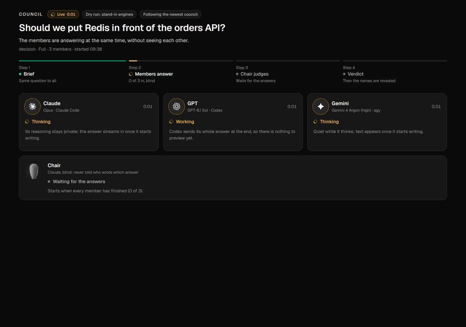
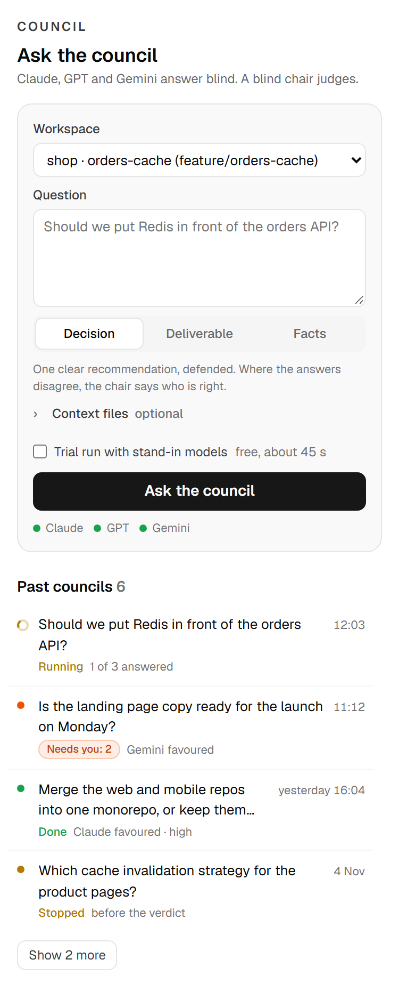
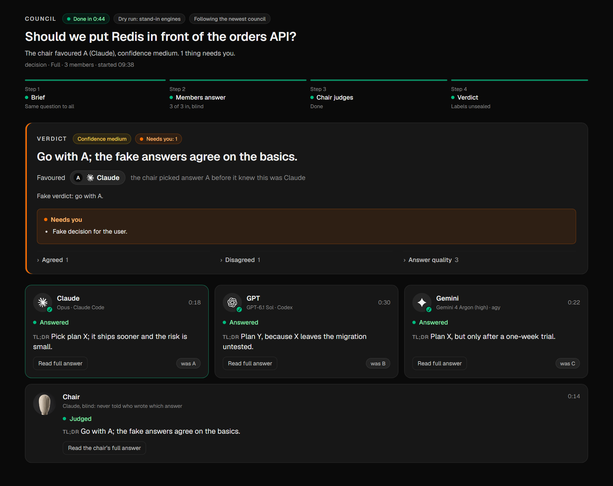

# Council for Orca

Ask one question. **Claude, GPT (Codex CLI) and Gemini (agy)** answer it independently, without seeing each other. A **blind Claude chair** then judges the shuffled answers as A, B and C, with model names removed. Only after the verdict are the labels unsealed. You watch the whole thing live in an [Orca](https://github.com/stablyai/orca) tab.



This is independent review followed by a blind judge, not a majority vote. The chair can favour the answer that disagreed with the other two.

| Ask in the panel | Watch the verdict |
|---|---|
|  |  |

## What you need

| | Required? | Why |
|---|---|---|
| [Orca](https://github.com/stablyai/orca) 1.4.248 or newer | yes | shows the Council tab |
| Node.js 20 or newer | yes | runs the council runner |
| `claude` ([Claude Code](https://code.claude.com)), signed in | yes | a member, and the blind chair |
| `codex` ([Codex CLI](https://github.com/openai/codex)), signed in | recommended | the GPT member |
| `agy` (Google Antigravity CLI), signed in | recommended | the Gemini member |

A council runs on **your own CLI subscriptions**: one call per member plus one for the chair. A missing member is skipped and the verdict says so. Two answers make a degraded council, one answer is not a council.

## Install and use

**1. Add the plugin to Orca.** Settings → Plugins → *Turn on plugins* → *Install plugin* → **Git URL**:

```
https://github.com/VukanCekic/orca-council
```

**2. Approve what it asks for.** Orca lists it before anything runs. Here is what each line is for:

| Orca says | Why Council needs it |
|---|---|
| Runs its own code in a separate Node.js process … with your user account's access | The worker reads each council's files to draw the tab |
| Read the name, branch, and terminal list of your focused workspace … | To pre-select the workspace you are in |
| Type and run commands in your terminals, local and SSH | To open one **Council** terminal running the council when you press Ask. Your question goes into a brief file, never into the command line. Council never types into your other terminals |
| Open your workspaces and their files in Orca, and run its built-in commands | To reopen a past council's tab when you click it in the list |

It makes no network requests of its own; the CLIs it starts talk to their own services. The code is short: [worker.mjs](worker.mjs), [lib/](lib/), [runner/](runner/).

**3. Ask.** Click the **Council** icon in Orca's right sidebar. Type a question, pick a mode, press **Ask the council**. A *Council* terminal opens in that workspace and the Council tab opens by itself and fills in live. Tick **Trial run** the first time: stand-in models, no AI usage, about 45 seconds.

**Where councils go.** Each council is saved in the workspace's `.council/` folder, which ignores itself in git, so nothing gets committed. The panel lists them; click one to reopen its tab. `.council/live.view` in the file tree always shows the newest.

### Advanced: the terminal

The panel runs `runner/council.mjs`, and you can run it yourself from any Orca terminal (clone the repo first):

```bash
node ~/orca-council/runner/council.mjs doctor
node ~/orca-council/runner/council.mjs decision "Should we put Redis in front of the orders API?" --context docs/orders-api.md
node ~/orca-council/runner/council.mjs decision "Test question" --dry-run --pace 1
```

## Modes and options

| Mode | For | Members |
|---|---|---|
| `decision` | plans, architecture, tool choices | all three, blind chair |
| `deliverable` | a page, doc or plan before it ships | all three; the verdict reminds you it is not a test |
| `facts` | a research report before you act on it | Codex fact-checks, the chair triages. `--full` for all three |

```
node runner/council.mjs <decision|deliverable|facts> ("question" | --brief brief.md)
  --context <file>   inline a file for every member (repeatable; the prompt is capped near 25k characters)
  --project <dir>    folder the members may read (default: current folder)
  --members <list>   e.g. claude,codex
  --timeout <min>    per engine, default 15
  --root <dir>       councils folder (or COUNCIL_ROOT)
  --dry-run          stand-in engines, no AI usage (--pace 1 plays them at real speed)
  --no-open          do not open the tab in Orca
```

Models default to `opus`, `gpt-6.1-sol` and `gemini-4-argon-high`. Change them with `COUNCIL_CLAUDE_MODEL`, `COUNCIL_CODEX_MODEL` and `COUNCIL_AGY_MODEL`, using any model id your CLI accepts.

Exit codes: `0` verdict written (also when degraded), `2` no member answered, `3` the chair failed, `1` bad input.

## How it stays blind and read-only

```
brief ──► Claude ─┐                        ┌─► answers/A.md ─┐
      ──► GPT    ─┼─ shuffled, names ──────┼─► answers/B.md ─┼─► blind chair ─► verdict.md ─► unseal
      ──► Gemini ─┘  redacted for chair    └─► answers/C.md ─┘   (no tools)       sealed.json → names
```

- **Members are read-only.** Claude runs with only Read/Grep/Glob, `--restricted` and no MCP servers. Codex runs with `-s read-only`, `--ignore-user-config` and `--ephemeral`. agy runs with `--mode plan --sandbox` in an empty throwaway folder; the runner warns if a file ever appears there.
- **The chair is blind.** It sees only the shuffled answers, with product and model names replaced by `[model]`. It has no tools at all and runs in an empty temp folder. The label-to-model mapping (`sealed.json`) never reaches it.
- **Everything stays on disk** in the council's folder: brief, prompts, each CLI's raw output, the answers, the verdict and an `index.jsonl` log.

## Use it from Claude Code

Copy [skills/council](skills/council) into `~/.claude/skills/`. Then `/council decision <what>` writes the brief, runs the runner and presents the verdict, starting with what needs you.

## Develop

```bash
node --test                          # 36 tests: tab reader, worker, Ask panel requests, runner (stand-in engines)
orca plugin validate . --json
orca plugin dev load . --json        # loads as local.council; review the approval it returns
```

To see the tab without spending AI usage, load the plugin, run a paced dry run (`COUNCIL_FAKE_PACE=1 node runner/council.mjs decision "Test" --dry-run`) and watch it in Orca.

Tested on Windows 11 with Orca 1.4.248 and Node 24. The runner is written for macOS and Linux too, but it has not been run there yet. Issues and reports are welcome.

## Credits

Geist font by Vercel (SIL OFL 1.1, [editor/fonts/OFL-Geist.txt](editor/fonts/OFL-Geist.txt)). Company marks from [Lobe Icons](https://github.com/lobehub/lobe-icons) (MIT, [editor/LICENSE-lobe-icons.txt](editor/LICENSE-lobe-icons.txt)). Claude, GPT, Codex, Gemini and Orca are trademarks of their owners. This plugin is not affiliated with Anthropic, OpenAI, Google or Stably.

MIT licence, see [LICENSE](LICENSE).
